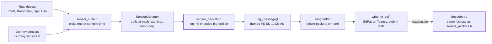

# Part 2: Making logging and sensors fit together

[← Overview](README.md)

Logging and sensors were written separately and merged without a shared contract for what a log packet looks like. The fix: one header owns the sensor structs and their byte layout, one class owns polling, and a test pins every byte against the Python decoder.



The two highlighted boxes are the contract: `sensor_packets.h` writes the bytes, `decoder.py` reads them, and golden-byte tests pin the two together.

## What the merge broke

- **The dummy loggers were deleted.** `ImuLogger` and `BaroLogger` (plus their `imu_raw_t` struct) lived in `logging_interface.h`. The sensor classes replaced them, but `test_logging` still used them, so the whole suite stopped compiling.
- **A declaration vanished.** A reformat of `logging_subsystem.h` dropped `uint32_t logging_lost_bytes();`. The function was still defined in the `.cpp`, but no other file could call it.
- **The real loggers couldn't be tested.** Each sensor's `loggable()` was a method on a class whose header pulls in a hardware library (`SparkFunLSM9DS1.h`, `ubx.h` ...), so the byte layout couldn't be checked on a laptop.

## sensor_packets.h: one home for the log format

`systems/sensors/sensor_packets.h` has no hardware dependencies. It holds:

- the five data structs: `ImuData`, `BaroData`, `PitoData`, `GpsData`, `sensor_trust_limits`
- a payload length constant for each (`IMU_PAYLOAD_LEN = 36` ...)
- `encode_*()` functions that write each struct big-endian into a byte buffer
- `log_*()` helpers that encode and call `log_message()` in one step

Every real driver's `loggable()` is now one line:

```cpp
bool ImuK::loggable(uint8_t system_code, uint8_t subsystem_code,
                    const void *structPtr) const {
    return log_imu(system_code, subsystem_code,
                   *static_cast<const ImuData *>(structPtr));
}
```

The byte layout is unchanged from what the teammates wrote. It was only moved, so existing logs still decode.

## The decoder contract

`systems/logging/decoder.py` has to agree with the firmware byte for byte. Every packet type now has a golden-byte test, where the expected bytes come from Python's `struct.pack` with the decoder's own format string:

| Packet | Sub ID | Payload | `decoder.py` format |
| --- | --- | --- | --- |
| IMU | 0x01 | 36 B | `>9f` |
| Barometer | 0x02 | 8 B | `>2f` |
| GPS | 0x03 | 44 B | `>2d5f4bi` |
| Pitot | 0x04 | 8 B | `>2f` |
| Sensor trust limits | 0x05 | 4 B | `>4B` |

If someone changes a struct and forgets the decoder (or the other way round), `test_logging` fails. All five packets were also written through the real logging code and run through `decoder.py`. Every field came back exact, with 0 bytes skipped.

## SensorManager and RateGate

`main.cpp` used to poll the sensors itself, using `Periodic` objects built on Teensy's `elapsedMicros`, and logged hard-coded placeholder values. That logic now lives in `sensor_manager.h` so it can be tested:

- **`RateGate`** is a scheduler that takes the time as an argument (`due(now_us)`) instead of reading a hardware timer. That makes it testable, and it survives `micros()` wrapping after 71 minutes. If the loop falls more than one period behind, it skips the missed ticks instead of firing five times in a row.
- **`SensorManager<Imu, Baro, Gps, Pitot>`** is a template over the four sensor types. `begin()` starts every sensor (a sensor that fails to start is marked FAILED, which doesn't stop the others) and logs the trust limits once. `update(now_us, log_enabled)` polls each sensor at its rate and logs a sample **only if it's fresh**, keeping read / logged / stale counts per sensor.

Rates (Hz) are unchanged: IMU `CALL_IMU` 100, barometer `CALL_BARO` 190, GPS `CALL_GPS` 10, pitot `CALL_PITOT` 50. All four can be overridden with `-D`.

## The new main.cpp

```cpp
static sensors::SensorSuite suite;   // real or dummy, see Part 4

void setup() {
    logging_ok = initialize_sd();
    suite.begin(logging_ok);
}

void loop() {
    suite.update(micros(), logging_ok);
    if (logging_ok && !write_to_sd()) {
        write_errors++;
    }
    // 'q' closes the log, status every 5 s, LED blink
}
```

Every 5 s the status line now also shows `lost_bytes` and each sensor's health, and whether the build is real or dummy.
