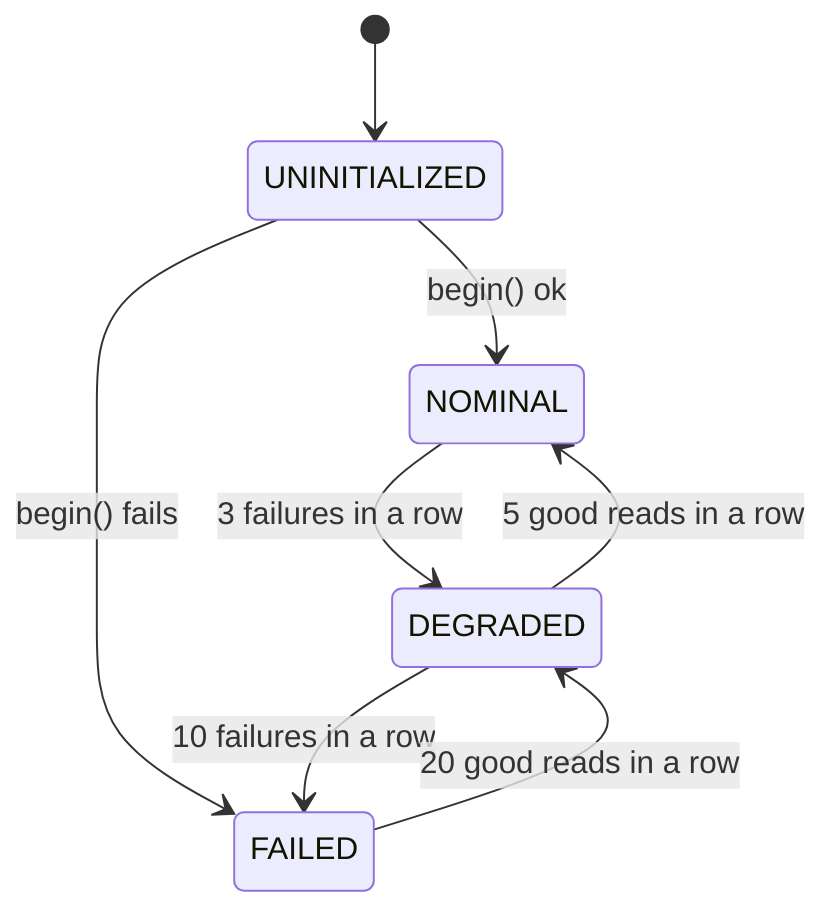

# Part 3: Sensor driver bugs

[← Overview](README.md)

Checking each driver against its library's source turned up nine bugs. Most would have failed silently on the bench: wrong numbers, or nothing logged, with no error. The health tracker had five more.

## How they were found

The four sensor libraries were cloned from GitHub (libdriver/bmp390, bolderflight/ublox, bolderflight/ms4525do, sparkfun/SparkFun_LSM9DS1_Arduino_Library). Every call our drivers make was checked against the real function signatures and return conventions. Most of these bugs are about meaning, not syntax. They compile cleanly, so only reading the library tells you they're wrong.

## The driver bugs

| # | File | Bug | What would have happened | Fix |
| --- | --- | --- | --- | --- |
| 1 | `ImuK.cpp` | Accelerometer converted with `calcGyro()`, and never turned from g into m/s² | Accel wrong by the ratio of two unrelated scale factors; `ImuData` says m/s² | `calcAccel(...) * 9.80665f` |
| 2 | `ImuK.cpp` | Magnetometer converted with `calcGyro()` | Mag readings meaningless | `calcMag()` |
| 3 | `Gps.cpp` | Constructor body `bfs::Ubx sensor(&Serial1);` declares a *new local variable* that shadows the member | The real member is default-built, never tied to Serial1; `Begin()` talks to no port | Initialise the member: `Gps::Gps() : sensor(&Serial1) {}` |
| 4 | `Gps.cpp` | `fail = sensor.Read()`, but `Read()` returns **true** on new data | Fields copied only when there was *no* new fix | Renamed to `got_new`, copy when true |
| 5 | `Gps.cpp` | `gr_speed = north_vel_mps()` | Ground speed = north velocity | `gnd_spd_mps()` |
| 6 | `Gps.cpp` | `begin()` never started health tracking | GPS stuck UNINITIALIZED forever | `m_health.begin(ok)` |
| 7 | `Barometer.cpp` | `bool ok = sensor_init(...)`, but libdriver returns **0 on success** | A dead barometer reported as started, a working one as failed | `== 0` |
| 8 | `Pito.cpp` | `get()` never updated health | Pitot health never changed | `update_sensor_freshness(ok)` |
| 9 | all four | `isFresh()` was `return false; // PLACEHOLDER` | With "only log fresh samples", **nothing would ever be logged** | Returns `m_health.fresh()` |

Bug 3 is the classic C++ trap. Inside a constructor, `Type name(args);` creates a new local object that dies at the closing brace. It doesn't initialise the member with the same name. Members are initialised in the initialiser list, after the colon.

`ImuK::begin()` is now explicit (`sensor.begin() != 0`), because the SparkFun `begin()` returns a WHO_AM_I value, not a bool. The GPS baud is a `GOOSE_GPS_BAUD` define (default 921600, the teammates' value).

## The missing BMP390 glue

The libdriver BMP390 library is portable C. It doesn't know about Teensy, so it calls 11 functions you must supply: `bmp390_interface_iic_read`, `_iic_write`, `_delay_ms`, `_debug_print` and so on. Nobody had written them, so the barometer could never have linked.

`systems/sensors/bmp390_teensy_interface.cpp` implements them on `Wire`. One detail matters: libdriver passes **8-bit** I2C addresses (`0x76 << 1`), while Arduino's `Wire` wants 7-bit, so every call shifts right by one. The SPI hooks return failure because the barometer is on I2C. Debug output goes to `Serial`.

## SensorHealth: the state machine

`SensorHealth` is meant to move a sensor between NOMINAL, DEGRADED and FAILED based on runs of good and bad reads. The original had five bugs:

- **Missing `break`s.** The `switch` cases fell through, so a FAILED sensor checked the DEGRADED rule straight after.
- **Wrong counter.** The failure branch compared `num_successes`, which it had just set to 0, against the thresholds, so a sensor could never degrade.
- **Wrong direction.** A degraded sensor that kept failing went to **NOMINAL**.
- **`degrade()` set NOMINAL.**
- **No limits.** The `sensor_trust_limits m_cfg` was never set, so the thresholds were whatever happened to be in memory.

The rewrite keeps the same idea, with every transition explicit:

Default limits are `{3, 10, 5, 20}`, settable per sensor. `degrade()` forces DEGRADED from any state. One success resets the failure streak and the other way round. Counters saturate at 255 instead of wrapping to 0. `on_success()` / `on_failure()` were declared but never defined, and are now real. `fresh()` reports whether the last read produced new data, which is what `isFresh()` returns. Comparisons use `>=` (reaching the count triggers the change). That's flagged for the team in [Part 6](06-open-items.md).
