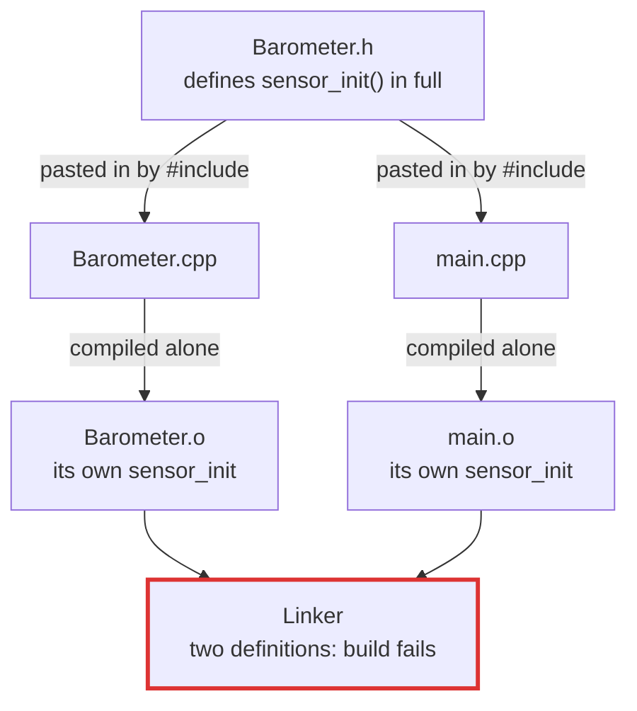

# Part 4: C++ build mechanics, native vs hardware

[← Overview](README.md)

Most of this branch's confusion comes down to three C++ facts: `#include` is copy-paste, every `.cpp` compiles alone, and the linker joins the results. Once those are clear, the multiple-definition error, header guards and the native/hardware split all follow.

## Multiple definition, from first principles

Before the fix, `Barometer.h` held two complete functions:

```cpp
// Barometer.h (before)
uint8_t sensor_init(bmp390_interface_t interface, ...) {
    ...   // ~150 lines of driver setup
}
uint8_t bmp390_basic_read(float *temperature_c, ...) {
    ...
}
```

Both `Barometer.cpp` and `main.cpp` include that header. The build then goes like this:

1. **Preprocess.** `#include "Barometer.h"` pastes the header's text into each file, so both now contain the full body of `sensor_init`.
2. **Compile, separately.** `Barometer.cpp` becomes `Barometer.o` and `main.cpp` becomes `main.o`, each with its own compiled `sensor_init`. Each file compiles fine alone, because each only sees one copy.
3. **Link.** The linker joins all the `.o` files, finds two functions with the same name and no rule for picking one, and stops:

```
multiple definition of `sensors::sensor_init(...)'
  first defined here: Barometer.o
```



This is the **one-definition rule**: an ordinary function may be *declared* as often as you like, but *defined* only once in the whole program.

**Why "Fixed header gaurds" didn't fix it.** An `#ifndef` guard stops a header being pasted twice into the *same* `.cpp`. Every `.cpp` starts compiling with no macros defined, so the guard does nothing *across* files.

### Two fixes

| Fix | How | Trade-off |
| --- | --- | --- |
| `inline` | Mark the functions `inline`: "may appear in several files, all copies identical, keep one" | One word; fine for small helpers. `put_be32` in `logging_subsystem.h` is `static inline` for this reason, and functions inside a class body and templates are inline automatically |
| Move the body (what we did) | Header keeps only the declaration; the body lives in `Barometer.cpp` | The header stays short, the 150-line body is compiled once, and the header says *what*, not *how* |

```cpp
// Barometer.h (after): declaration only
uint8_t sensor_init(bmp390_interface_t interface,
                    bmp390_address_t addr_pin,
                    bmp390_handle_t *m_sensor);

// Barometer.cpp: the one definition
uint8_t sensor_init(...) { ... }
```

Rule of thumb: **a function body in a header must be `inline`, a template, or inside a class. Anything else goes in a `.cpp`.**

## Header guards

The repo had three styles: `#pragma once`, short guards like `IMU_` / `BARO_`, and `FAULT_TABLE_H_`. All 22 project headers now use one scheme:

```cpp
#ifndef GOOSE_SENSORS_RATE_GATE_H_
#define GOOSE_SENSORS_RATE_GATE_H_
...
#endif // GOOSE_SENSORS_RATE_GATE_H_
```

The name is `GOOSE_` + folder + file (CamelCase split with `_`) + `_H_`. Why it beats the old ones:

- **Portable and explicit.** `#pragma once` is supported almost everywhere, but it's non-standard, and it can be fooled by copies of a file or symlinks. A guard is plain standard C++.
- **No collisions.** A short guard like `IMU_` will clash the day a library or a second `imu.h` uses the same name. The second header is then silently skipped and you get baffling "not declared" errors. Folder plus file plus the project prefix makes that practically impossible.
- **Readable endings.** The `#endif // NAME` comment tells you what a stray `#endif` closes.

## Native vs hardware: the GNC_HARDWARE_BUILD split

There are two kinds of build. `teensy41` runs on the board with the real `Arduino.h`, `Wire`, SdFat and sensor libraries. `native` runs on your laptop for unit tests and has none of them. Every file in `systems/` falls into one of three groups:

| Group | Files | In the native build |
| --- | --- | --- |
| Pure C++, no Arduino | `state/*`, `ring_buffer.h`, `logging_interface.h`, `sensor_packets.h`, `SensorHealth.*`, `DummySensors.h`, `sensor_manager.h`, `rate_gate.h` | Built and tested as is |
| A little Arduino | `logging_subsystem.cpp` (`millis()`, `Serial`, SD card) | Built against fakes in `test/stubs/`: a fake `Arduino.h`, and a fake SD card that records every byte written |
| Real hardware drivers | `ImuK`, `Barometer`, `Gps`, `Pito`, `bmp390_teensy_interface.cpp` | `.cpp` compiles to nothing; `.h` stops the build with a message |

`GNC_HARDWARE_BUILD` is the switch. Only the Teensy environments define it. The driver `.cpp` files are wrapped:

```cpp
// HARDWARE ONLY: compiled to nothing unless GNC_HARDWARE_BUILD is defined
#ifdef GNC_HARDWARE_BUILD
...the whole driver...
#endif // GNC_HARDWARE_BUILD
```

and the driver headers refuse to be included off-board:

```cpp
#ifndef GNC_HARDWARE_BUILD
#error "ImuK.h is hardware-only. Include sensor_suite.h instead."
#endif
```

That let the native environment take all of `systems/` (`+<../systems/>`) instead of a hand-kept file list that broke every time someone added a file. The native object files for the four drivers were checked and come out with zero symbols.

`logging_interface.h` used to include `<Arduino.h>` without using anything from it. It now includes `<stdint.h>`, which is one less hidden hardware dependency.

## Real vs dummy sensors

No code includes a driver header directly. It includes `sensor_suite.h`, which picks the sensors with the preprocessor:

```cpp
#if defined(GNC_HARDWARE_BUILD) && !defined(GOOSE_DUMMY_SENSORS)
#include "ImuK.h"   // ...and the other three drivers
using ImuSensor = ImuK;
#else
#include "DummySensors.h"
using ImuSensor = DummyImu;
#endif
using SensorSuite = SensorManager<ImuSensor, BaroSensor, GpsSensor, PitotSensor>;
```

| Build | `GNC_HARDWARE_BUILD` | `GOOSE_DUMMY_SENSORS` | You get |
| --- | --- | --- | --- |
| `teensy41` | yes | no | real drivers |
| `teensy41_dummy` | yes | yes | dummies on a real Teensy, real SD card |
| `native` | no | (no need) | dummies, stub SD |

The dummies (`DummyImu`, `DummyBaro`, `DummyGps`, `DummyPitot`) have exactly the driver interface: `begin()`, `get()`, `getStatus()`, `isFresh()`, `loggable()`, `health()`. Each sample is deterministic and different from the last. Tests can make a sensor fail to start (`set_fail_begin`) or fail every read (`set_failing`). Because `SensorManager` is a template, the same polling and logging code runs against either set, with no virtual calls on the Teensy.

`main.cpp` is Teensy-only: the native environment excludes `src/` entirely.
